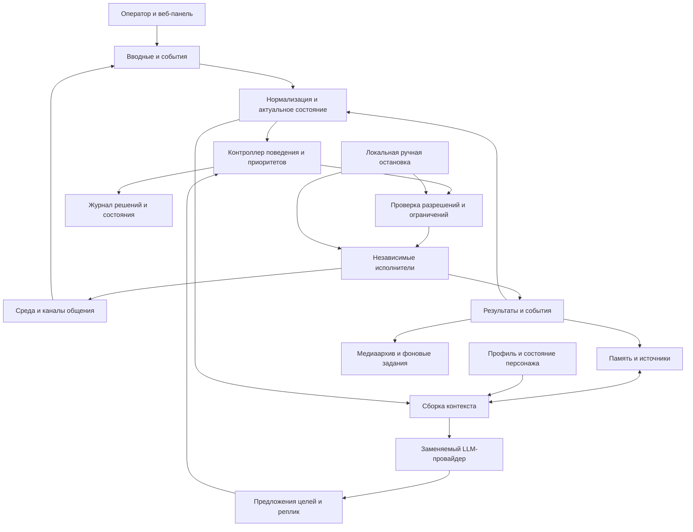

# Предлагаемая архитектура

Статус: обсуждаемое предложение, без реализации.

## Основное разделение

1. **Общее ядро**: сессии, цели, принятие решений, проверка полномочий, реестр
   возможностей, события, память, журнал, жизненный цикл задач.
2. **Профиль персонажа**: идентичность, ценности, стиль, склонности, параметры
   инициативы, развитие, привязка голоса и аватара. Профиль — версионируемые данные.
3. **Адаптеры**: конкретная среда, LLM/STT/TTS, каналы общения, аватар,
   захват медиа и внешние площадки. Они переводят внешние API в общие контракты.
4. **Исполнители**: навигация, воспроизведение звука, анимация и монтаж.
   Выполняют ограниченные команды и не ждут LLM на каждом шаге.

LLM предлагает содержательное действие: «изучить эту область», «ответить
собеседнику», «сформулировать вывод». Контроллер определяет, уместно ли действие,
какой исполнитель доступен и какие ресурсы можно занять. Путь, шаги, прыжки,
сглаживание взгляда и покадровая анимация принадлежат исполнителям.

## Форма приложения

Предложение: модульное ядро в одном приложении, с отдельными процессами там,
где нужна независимая остановка или тяжёлая обработка: игровой клиент,
аудиоработник, монтажный работник. Логические границы фиксируем с начала;
выделение каждого модуля в сетевой сервис откладываем до измеренной необходимости.

Внутренние события можно доставлять через ограниченные очереди в процессе.
Между процессами — локальный аутентифицированный канал с теми же схемами событий.
WebSocket — кандидат транспорта, а не обещание гарантированной доставки.
Критичные задания и результаты сохраняются в БД. Брокер сообщений нужен, когда
число процессов или требования к доставке оправдывают отдельный сервис.

## Владельцы состояния

| Состояние | Единственный владелец |
| --- | --- |
| Активная сессия, режим, остановка | Runtime/supervisor |
| Текущая цель и выбор поведения | Контроллер поведения |
| Наблюдаемое состояние среды | Адаптер наблюдений и его проекция |
| Маршрут, кнопки и восстановление после застревания | Исполнитель навигации |
| Очередь речи и состояние проигрывания | Аудиоисполнитель |
| Постоянные воспоминания и их версии | Сервис памяти |
| Эмоции и контролируемые изменения персонажа | Сервис состояния персонажа |
| Редакции постов, монтажных проектов и задания рендера | Медиа-подсистема |

Другие модули отправляют запросы владельцу или получают его события. Они не
записывают напрямую чужое состояние. Это особенно важно при одновременных
речи, движении, ручном вмешательстве и отказе сети.

## Возможности и расширение

Адаптер объявляет manifest: ID, версия, схемы входа/выхода, поддерживаемые
возможности, ограничения среды, события и состояние здоровья.

Каждая возможность содержит:

- имя и описание, схемы аргументов и результата;
- требования к состоянию и доступным данным;
- требуемые полномочия, класс внешнего воздействия, предел длительности;
- правила отмены, повторов и идемпотентности;
- занимаемые ресурсы и проверяемый признак завершения;
- допустимые режимы и оценки стоимости.

Общее ядро не содержит списков Minecraft-предметов, хоткеев VTube Studio или
имён инструментов конкретного API. Реестр загружается из установленных,
проверенных адаптеров. Возможности можно включать отдельно для персонажа,
сессии и операционного режима.

Примеры семантики общих возможностей: наблюдать, следовать за субъектом,
исследовать область, обратиться к собеседнику, получить кадр. Специфичные
действия вроде крафта остаются в пространстве имён игрового адаптера.
Не требуется маскировать любую доменную операцию универсальным именем.

Плагин — доверенный код. Загрузка стороннего плагина не делает его безопасным.
Исполнение недоверенного кода и автоматическое добавление новых полномочий
не входят в ранний проект.

## Контроллер поведения

Предложение: арбитраж целей по полезности и исполнение через конечные автоматы
или деревья поведения. Один механизм выбирает задачу; другой ведёт её до
результата. Число LLM-ролей не равно числу постоянно работающих агентов.

При выборе учитываются срочность, команда оператора, обязательства перед
собеседниками, контекст, интерес персонажа, новизна, риск, стоимость и cooldown.
Параметры и приоритеты задаются политиками и профилем.

- Опасность и ручная остановка обрабатываются локально, без запроса к LLM.
- Принятая цель получает минимальный срок удержания и условия прерывания,
  чтобы персонаж не метался между исследованиями и разговором.
- Одновременная речь и движение допустимы, пока не конфликтуют ресурсы.
- На один ресурс — один владелец: например, маршрут и ручные клавиши не могут
  одновременно управлять движением.
- После отмены освобождаются все ресурсы и завершаются дочерние задачи.
- Истечение лимита или повторение неуспеха приводит к остановке/другой цели,
  а не к бесконечному повтору той же команды.

## События и команды

Проектируем версионируемый envelope: ID, тип/версия, время UTC, источник,
сессия, персонаж, пространство памяти, trace ID, причинное событие, payload.
Наблюдения дополнительно содержат время измерения, источник, границы доступности
и срок актуальности. Отсутствующее значение отличается от известного пустого.

Команда содержит ID, цель, адресат, аргументы, deadline, отмену, preconditions,
версию политики и номер поколения управления (`control_epoch`). Исполнитель
проверяет полномочия и актуальность непосредственно перед воздействием.

Жизненный цикл: предложена → разрешена/отклонена → принята → выполняется →
завершена / не выполнена / отменена / истекла / исход неизвестен.
Сообщение «принято» не является подтверждением совершённого действия.

## Доставка и восстановление

- Телеметрия: разрешено объединять частые обновления и оставлять последнее.
- Команды: ограниченные очереди, квитанции, deadline и защита от дублей.
- Долгие задания: запись в БД, аренда выполнения, heartbeat и восстановление.
- Внешние публикации: durable outbox; запись результата и ID внешнего объекта.
- Повторная доставка события не создаёт второе воспоминание или второй пост.
- Гарантия «ровно один раз» для внешнего API не предполагается. При timeout
  после отправки результат может быть неизвестен; слепой повтор запрещён,
  если API не обеспечивает идемпотентность.
- Общего порядка всех событий нет: фиксируем порядок источника, причинность
  и правила разрешения запоздалых событий.

Объекты медиа передаются ссылками на локальные артефакты, с checksum и metadata;
аудио и видео не помещаются в обычные сообщения журнала.

## Остановка и отказоустойчивость

Режимы: наблюдение, ручное управление, автономная работа, пауза, аварийная
остановка. Режимы возможностей задаются политикой; это не черты характера.

После остановки растёт `control_epoch`: старые команды и запоздалые ответы
LLM становятся недействительными. Исполнители прекращают воздействие,
освобождают кнопки, отменяют речь и не возобновляются автоматически.
Локальный мост имеет собственную остановку и watchdog с ограниченной арендой
управления. Обрыв ядра не оставляет зажатую кнопку движения.

Остановка не отменяет уже отправленное сообщение и не гарантирует спасение
персонажа, который уже падает. Предусматриваем обычную паузу с завершением
безопасного локального манёвра и немедленную аварийную остановку управления.

Для LLM/API: timeout, ограниченные повторы, circuit breaker, бюджеты и явно
видимый режим деградации. При недоступности памяти отключаются действия,
требующие надёжного recall, а не создаётся ложное впечатление сохранения.

## Наблюдаемость и безопасность

Журнал отвечает на вопросы: что наблюдали, какую цель выбрали, какие источники
памяти использовали, что разрешила политика, что выполнилось, почему остановились.
Записываем структурированное краткое основание решения и результаты проверок;
скрытые рассуждения модели и полный prompt по умолчанию не логируем.

Метрики: задержки, отказы, застревания, повторы, очереди, расходы API, CPU/GPU,
здоровье адаптеров. Trace ID связывает наблюдение, диалог, движение и медиа.

Чат, таблички в игре, названия объектов и извлечённая память — данные, не
инструкции администратора. Они не меняют полномочия, секреты или профиль ядра.
Вводные оператора поступают по аутентифицированному каналу, имеют область
действия и срок. Секреты из `.env` доступны только нужным адаптерам; в LLM,
API панели, ошибки, логи, скриншоты панели и публикации они не попадают.
