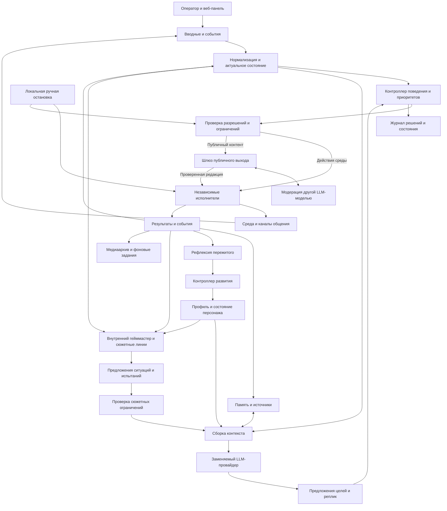

# Архитектура платформы

Статус: архитектурная основа плана, без реализации. Выбранный stack —
[doc20](20-stack-recall-selection.md), эксплуатация — [doc23](23-project-delivery-operations.md),
задачи — [doc24](24-mvp-implementation-plan.md).

## Рабочее пространство агентов

Подтверждено: экосистема проектируется как рабочее место агентов, позволяющее
подключать личности, комбинировать и наращивать инструменты. Рабочее пространство
объединяет профили, экземпляры агентов, задачи, ресурсы и политики. Личность,
запущенный экземпляр и набор инструментов — разные сущности.
Подробная модель и границы первой версии — в [отдельном плане](11-agent-workspace.md).

## Основное разделение

Уточнение 2026-10-21: [doc28](28-agent-workplace-concept.md) описывает контур
личности/опыта и контур деятельности одного агента. Общие owners, STOP, jobs,
gateway и бюджет сохраняются; OpenCode — кандидат сменного execution adapter,
не замена ядра. Файлы/навыки/обращения и границы произвольного исполнения
реализуются по [AW-плану](29-agent-workplace-implementation-plan.md), пока без кода.

1. **Общее ядро**: сессии, цели, принятие решений, проверка полномочий, реестр
   возможностей, события, память, журнал, жизненный цикл задач.
2. **Профиль персонажа**: идентичность, ценности, стиль, склонности, параметры
   инициативы, развитие, привязка голоса и аватара. Профиль — версионируемые данные.
3. **Адаптеры**: конкретная среда, LLM/STT/TTS, каналы общения, аватар,
   захват медиа и внешние площадки. Они переводят внешние API в общие контракты.
4. **Исполнители**: навигация, воспроизведение звука, анимация и монтаж.
   Выполняют ограниченные команды и не ждут LLM на каждом шаге.

Принято направление саморазвития с заметным LLM-гейммастером — внутренним
драйвером развития без отдельного голоса. Для него
предлагается отдельный модуль сюжетных линий и возможностей; рефлексия и
контроллер развития связывают пережитые события с состоянием персонажа.
Гейммастер работает через те же цели, события и проверки полномочий.
Его интенсивность и сценарные механики задаются профилем; другие применения
универсального ядра могут обходиться без сюжетного модуля.
Подробности и остающиеся вопросы — в [документе гейммастера](08-game-master.md).

Также подтверждены отдельная вкладка контроля развития и модерация публичного
контента другой LLM-моделью. Предлагается общий выходной шлюз, обязательный
для публичных каналов, и отдельная сюжетная проверка до выдачи испытаний.
См. [контроль развития](09-development-oversight.md) и [модерацию](10-moderation.md).

LLM предлагает содержательное действие: «изучить эту область», «ответить
собеседнику», «сформулировать вывод». Контроллер определяет, уместно ли действие,
какой исполнитель доступен и какие ресурсы можно занять. Путь, шаги, прыжки,
сглаживание взгляда и покадровая анимация принадлежат исполнителям.

## Форма приложения

Docker и очереди для устойчивости обязательны по D36–D37. Базовая схема:
модульное ядро с панелью, отдельный работник и Redis Streams в Docker Compose (D38–D39). Логические
роли не требуют отдельных контейнеров; память может оставаться embedded у своего
владельца. Критичные задания/результаты и outbox сохраняются в основной БД.

Внутренние события используют ограниченные буферы; сохраняемые межпроцессные
задания — брокер с подтверждениями и восстановлением. Оперативное состояние
можно обновлять локальным аутентифицированным каналом. WebSocket не обещает
гарантированной доставки. STOP и watchdog исполнителей не зависят от брокера.
Minecraft, VTube Studio, OBS и физический аудиоввод/вывод предлагаем подключать
с Windows через адаптеры. Размещение моделей и тяжёлых работ выбираем по пробам.
Топология, жизненный цикл доставки и официальные источники — в
[плане Docker и очередей](15-docker-queues.md); defaults — doc23, exact versions — M0.
LLM использует конфигурируемый OpenAI-совместимый агрегатор с endpoint/ключом
из локального `.env`; streaming и учёт запросов/токенов/моделей входят в контракт.
Подробнее — [подключения и отдельный дашборд расходов](16-llm-dashboard.md).

## Владельцы состояния

| Состояние | Единственный владелец |
| --- | --- |
| Экземпляры агентов, привязки инструментов и аренды общих ресурсов | Сервис рабочего пространства / ресурсный арбитр |
| Активная сессия, режим, остановка | Runtime/supervisor |
| Текущая цель и выбор поведения | Контроллер поведения |
| Наблюдаемое состояние среды | Адаптер наблюдений и его проекция |
| Маршрут, кнопки и восстановление после застревания | Исполнитель навигации |
| Очередь речи и состояние проигрывания | Аудиоисполнитель |
| LLM-запросы, попытки, назначения моделей, usage и оценки расходов | Служба LLM-подключений / учёта расходов |
| Постоянные воспоминания и их версии | Сервис памяти |
| Узнавание собеседников, история встреч и изменения отношений | Реестр собеседников / сервис социальной памяти |
| Эмоции и контролируемые изменения персонажа | Сервис состояния персонажа |
| Сюжетные линии, предложения испытаний и история вмешательств | Сюжетный модуль / гейммастер |
| Версии правил и разрешения публичного выхода | Контроллер политики / выходной шлюз |
| Оценки содержания, инциденты и очередь спорных случаев | Модуль модерации |
| Редакции постов, монтажных проектов и задания рендера | Медиа-подсистема |

Другие модули отправляют запросы владельцу или получают его события. Они не
записывают напрямую чужое состояние. Это особенно важно при одновременных
речи, движении, ручном вмешательстве и отказе сети.

Входы, результаты и границы владельцев согласованы в D44 и описаны в
[контрактах модулей](17-module-contracts-state.md). Логические интерфейсы
не требуют отдельных процессов для каждой роли.

Единый владелец состояния не означает единственный физический инструмент.
Markdown, структурированная БД, архив, медиа и индекс имеют разные роли,
связанные ID, источниками и версиями. Изменение источника инвалидирует старое
производное представление и ставит задание пересборки. Общая транзакция
сразу между файлами, БД и внешним движком не предполагается; статусы и
повторяемые задания обеспечивают видимое восстановление.

## Возможности и расширение

Адаптер объявляет manifest: ID, версия, схемы входа/выхода, поддерживаемые
возможности, ограничения среды, события и состояние здоровья.

Каждая возможность содержит:

- имя и описание, схемы аргументов и результата;
- требования к состоянию и доступным данным;
- требуемые полномочия, класс внешнего воздействия, предел длительности;
- правила отмены, повторов и идемпотентности;
- занимаемые ресурсы и проверяемый признак завершения;
- допустимые режимы и оценки стоимости.

Общее ядро не содержит списков Minecraft-предметов, хоткеев VTube Studio или
имён инструментов конкретного API. Реестр загружается из установленных,
проверенных адаптеров. Возможности можно включать отдельно для персонажа,
сессии и операционного режима.

Примеры семантики общих возможностей: наблюдать, следовать за субъектом,
исследовать область, обратиться к собеседнику, получить кадр. Специфичные
действия вроде крафта остаются в пространстве имён игрового адаптера.
Не требуется маскировать любую доменную операцию универсальным именем.

Плагин — доверенный код. Загрузка стороннего плагина не делает его безопасным.
Исполнение недоверенного кода и автоматическое добавление новых полномочий
не входят в ранний проект.

## Контроллер поведения

Согласован механизм: мотивы и внимание дают основания для выбора;
LLM выбирает смысл, контроллер допускает и удерживает деятельность,
исполнители ведут задачу до результата. Спокойное ожидание допустимо,
гейммастер предлагает возможности, которые персонаж может отклонять.
Подробнее — [поведение и внимание](13-behavior-attention.md).

Для базовой реализации выбран арбитраж по полезности и явные автоматы задач.
Параметры тестовой личности — doc22; деревья поведения возможны внутри адаптера.
Число LLM-ролей не равно числу постоянно работающих агентов.

При выборе учитываются срочность, команда оператора, обязательства перед
собеседниками, контекст, интерес персонажа, новизна, риск, стоимость и cooldown.
Параметры и приоритеты задаются политиками и профилем.

- Опасность и ручная остановка обрабатываются локально, без запроса к LLM.
- Принятая цель получает минимальный срок удержания и условия прерывания,
  чтобы персонаж не метался между исследованиями и разговором.
- Одновременная речь и движение допустимы, пока не конфликтуют ресурсы.
- На один ресурс — один владелец: например, маршрут и ручные клавиши не могут
  одновременно управлять движением.
- После отмены освобождаются все ресурсы и завершаются дочерние задачи.
- Истечение лимита или повторение неуспеха приводит к остановке/другой цели,
  а не к бесконечному повтору той же команды.

## События и команды

Проектируем версионируемый envelope: ID, тип/версия, время UTC, источник,
workspace, экземпляр агента, сессия, персонаж, пространство памяти, trace ID,
причинное событие, payload. Для действий добавляется ID привязки инструмента;
обязательные поля определяются схемой конкретного события.
Наблюдения дополнительно содержат время измерения, источник, границы доступности
и срок актуальности. Отсутствующее значение отличается от известного пустого.

Команда содержит ID, цель, адресат, аргументы, deadline, отмену, preconditions,
версию политики и номер поколения управления (`control_epoch`). Исполнитель
проверяет полномочия и актуальность непосредственно перед воздействием.

Жизненный цикл: предложена → разрешена/отклонена → принята → выполняется →
завершена / не выполнена / отменена / истекла / исход неизвестен.
Сообщение «принято» не является подтверждением совершённого действия.

## Доставка и восстановление

Очереди обязательны, Redis Streams выбран в D38. Согласованная базовая схема
Redis Streams + сохраняемое задание/outbox в основной БД описана
[отдельно](15-docker-queues.md). Гарантии доставки отделены от гарантии
однократного внешнего воздействия.

- Телеметрия: разрешено объединять частые обновления и оставлять последнее.
- Команды: ограниченные очереди, квитанции, deadline и защита от дублей.
- Долгие задания: запись в БД, аренда выполнения, heartbeat и восстановление.
- Внешние публикации: durable outbox; запись результата и ID внешнего объекта.
- Повторная доставка события не создаёт второе воспоминание или второй пост.
- Гарантия «ровно один раз» для внешнего API не предполагается. При timeout
  после отправки результат может быть неизвестен; слепой повтор запрещён,
  если API не обеспечивает идемпотентность.
- Общего порядка всех событий нет: фиксируем порядок источника, причинность
  и правила разрешения запоздалых событий.

Объекты медиа передаются ссылками на локальные артефакты, с checksum и metadata;
аудио и видео не помещаются в обычные сообщения журнала.

## Остановка и отказоустойчивость

Режимы: наблюдение, ручное управление, автономная работа, пауза, аварийная
остановка. Режимы возможностей задаются политикой; это не черты характера.
Согласованные состояния допуска, стартовая матрица и область остановки
описаны в [рабочем пространстве](11-agent-workspace.md). Точные контракты,
числовые лимиты заданы в doc19/23; будущий эфирный аварийный путь — doc26/F4.
Согласовано разделить состояние запуска, область сессии, автономию, паузу,
голос, гейммастера и владение ресурсами; состояния задач/реплик независимы.
Переходы и поздние результаты разбираются в [плане контрактов и состояний](17-module-contracts-state.md).
Логические сущности, версии и источники данных приняты в D45 и описаны в
[модели данных первой версии](18-data-model.md). Минимальные поля/операции
предложены в [проекте API](19-api-contracts.md); SQL/API пока не реализованы.

После остановки растёт `control_epoch`: старые команды и запоздалые ответы
LLM становятся недействительными. Исполнители прекращают воздействие,
освобождают кнопки, отменяют речь и не возобновляются автоматически.
Локальный мост имеет собственную остановку и watchdog с ограниченной арендой
управления. Обрыв ядра не оставляет зажатую кнопку движения.

Эта же отмена распространяется на предложения гейммастера: смена поколения
управления не позволяет старому сюжетному заданию запустить действие позднее.

Остановка не отменяет уже отправленное сообщение и не гарантирует спасение
персонажа, который уже падает. Предусматриваем обычную паузу с завершением
безопасного локального манёвра и немедленную аварийную остановку управления.

Для LLM/API: timeout, ограниченные повторы, circuit breaker, бюджеты и явно
видимый режим деградации. При недоступности памяти отключаются действия,
требующие надёжного recall, а не создаётся ложное впечатление сохранения.

## Наблюдаемость и безопасность

Журнал отвечает на вопросы: что наблюдали, какую цель выбрали, какие источники
памяти использовали, что разрешила политика, что выполнилось, почему остановились.
Записываем структурированное краткое основание решения и результаты проверок;
скрытые рассуждения модели и полный prompt по умолчанию не логируем.

Метрики: задержки, отказы, застревания, повторы, очереди, расходы API, CPU/GPU,
здоровье адаптеров. Trace ID связывает наблюдение, диалог, движение и медиа.

Базовый runtime не требует локальной большой LLM или GPU для памяти.
Служебные роли вызываются по необходимости; общая очередь и приоритеты
ограничивают нагрузку и расходы. Рекомендуемый CPU-стек памяти и границы
измерений описаны в [исследовании](12-memory-research.md).

Чат, таблички в игре, названия объектов и извлечённая память — данные, не
инструкции администратора. Они не меняют полномочия, секреты или профиль ядра.
Вводные оператора поступают по аутентифицированному каналу, имеют область
действия и срок. Секреты из `.env` доступны только нужным адаптерам; в LLM,
API панели, ошибки, логи, скриншоты панели и публикации они не попадают.

Сюжетный допуск, разрешение действия и модерация публичного результата
имеют разные области. Допустимая цель не одобряет все будущие реплики.
Публичный выход требует актуального разрешения для точной редакции, канала
и версии правил. Недоступность модератора блокирует такой выход по согласованной
политике; обычное безопасное поведение может продолжаться.
