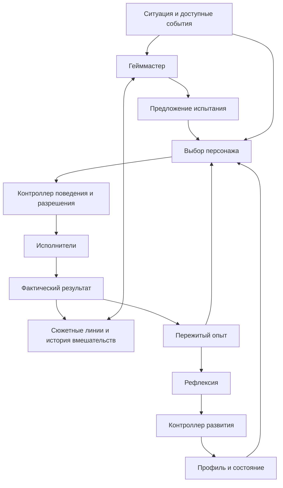

# Саморазвитие с заметным гейммастером

Дата: 2026-10-12. Статус: направление принято пользователем; приведённые
контракты, лимиты, случайность и способ присутствия — предложения для обсуждения.
Документ относится к планированию, реализация не начата.

## Принятый выбор

Гейммастер активно предлагает приключения, испытания и изменяющиеся вводные.
Персонаж получает пространство для собственных решений и саморазвития.
История должна сохранять причинную связность и узнаваемость характера.

«Заметный» сейчас означает активность сюжетного вмешательства. Пользователь
ещё не выбирал, будет ли гейммастер отдельным говорящим ведущим для персонажа
и зрителей. Интенсивность вмешательств и видимость роли — разные параметры.

## Предлагаемые роли

| Роль | Вход | Выход | Граница |
| --- | --- | --- | --- |
| Персонаж | Доступная ситуация, профиль, память, полученная вводная | Собственный выбор, реплика, предложение действия | Не обязан принимать каждое испытание |
| Гейммастер | Наблюдения, желания, история линий и вмешательств, ограничения среды | Предложение ситуации, цели или испытания | Не записывает заранее выбранный результат в биографию |
| Рефлексия | Пережитые эпизоды, выборы и результаты с источниками | Предложение изменения убеждения, отношения или привычки | Не превращает задумку гейммастера в факт |
| Контроллер развития | Предложение, доказательства, текущая версия состояния и политика | Применённое изменение либо причина отклонения | Сохраняет историю, пределы изменений и право на откат |

Это логические роли. Они могут использовать одну API-модель с отдельными
контекстами. Число процессов, моделей и частота вызовов решаются позже.
Механизмы сюжета задаются профилем и модулем; ядро сохраняет универсальность.

## Что хранить явно

У персонажа: желания, основания желаний, убеждения и уверенность, конфликтующие
мотивы, избегаемые ситуации, отношения и обязательства. Эти данные влияют
на выбор вместе с привычками и стилем; их названия и набор не зашиваются в ядро.

У гейммастера: открытые линии, связанные эпизоды, предлагаемые возможности,
последние вмешательства, история смысловых повторов и состояние завершения.
Задуманный исход отличается от фактического и может вообще не реализоваться.

Предложение испытания содержит ID, связь с линией, основания в доступных
наблюдениях, условия применимости, срок, необходимые возможности и ожидаемые
границы риска. Возможные исходы не являются обязательным сценарием.
После отказа, истечения или изменения контекста предложение не повторяется
без нового основания и согласованного cooldown.

## Полномочия в разных средах

В тестовой панели можно моделировать ситуации и виртуальных участников.
Они помечаются как симуляция и сохраняются в тестовом пространстве памяти.

На чужом Minecraft-сервере гейммастер использует реальные находки, предложения
игроков, доступные цели и действия персонажа. Он может предложить вернуться
к обещанию, проверить гипотезу, исследовать место или попытаться решить задачу
иначе. Он не обещает появление событий, которыми система не управляет.

Вымышленные вводные, внутренняя задача, метафора и фактическое наблюдение
имеют разные типы происхождения. Если позже появится отдельный сценический
режим, его условности нужно определить явно. Адаптер среды ограничивает,
какие вмешательства реально возможны.

Гейммастер не обходит безопасность, не управляет каждым шагом движения,
не меняет секреты/полномочия и не заставляет участника эфира играть заданную роль.
Его отказ не блокирует обычное поведение персонажа; устаревшие предложения
отменяются так же, как другие цели.

## Виртуальные кубики

Предлагаемая роль случайности: разнообразить выбор среди уже уместных
возможностей, интенсивность небольшого импульса и момент возвращения к теме.
Генератор случайности работает вне LLM; seed, контекст выбора и результат
сохраняются для воспроизведения теста.

Результаты настоящих действий определяет среда. Случайность не создаёт
подтверждённые события, не снимает ограничения и не переписывает личность
без пережитого основания. Диапазоны и таблицы задаются данными профиля.
Конкретная механика кубиков ещё не утверждена.

## Развитие и защита от циклов

Предлагаемый цикл: событие → выбор → результат → рефлексия → допустимое
изменение → другой выбор в следующей подходящей ситуации.

Рефлексию запускают новые значимые основания: результат цели, противоречие
убеждению, изменение отношения или завершение линии. Периодическая проверка
может завершиться без нового испытания и без изменения персонажа.

- Смысловой повтор учитывается независимо от формулировки задания.
- У линии есть условия завершения; повторное открытие требует нового основания.
- Отказ и неудача могут менять направление истории; не каждый исход — улучшение.
- Пересказ старой рефлексии не создаёт новое доказательство для изменения.
- Настроение, привычки и значимые убеждения имеют разные пределы изменения.
- Обычные занятия и спокойные эпизоды имеют право не двигать сюжетную арку.
- Персонаж не получает обязательную реплику «я усвоил урок» после каждой ситуации.

Условный пример: персонаж ценит самостоятельность и избегает помощи. После
реальной ошибки принимает помощь игрока, позже отвечает услугой, а в следующей
сложной задаче сам просит о конкретной поддержке. Его стиль и самостоятельность
могут сохраниться. Этот пример объясняет механизм и не задаёт характер проекта.

## Панель и проверка

Предлагается показывать оператору активные линии, выданные вводные, их
источники/статусы, вмешательства гейммастера, броски и историю развития.
Нужны отмена конкретного испытания, пауза гейммастера и управление интенсивностью
отдельно от остановки самого персонажа.

Проверяем на сериях текстовых сцен ещё до подключения игры:
узнаваемость характера, влияние опыта на следующий выбор, отсутствие выдуманных
воспоминаний, закрытие линий, отсутствие одинаковых уроков и нормальное
поведение при отказе/паузе гейммастера. Часть сцен должна остаться спокойной,
а часть предложений — быть отклонённой персонажем без поломки повествования.

## Открытые решения

1. Присутствие: за кадром, отдельный ведущий или смешанный режим.
2. Допустимые виды испытаний и степень свободы гейммастера.
3. Темп, число открытых линий и условия вмешательства.
4. Возможность автономного изменения базовых убеждений/ценностей.
5. Нужна ли явная игровая механика кубиков для зрителей.
6. Объём гейммастера в первой версии персонажа и панели.

Исследовательские ориентиры: память, рефлексия и планирование в
[Generative Agents](https://arxiv.org/abs/2304.03442), иерархический сюжетный
контекст в [Dramatron](https://deepmind.google/research/publications/13609/).
Связка ролей и ограничения выше — проектное предложение для нашего сценария,
а не готовая гарантия качества длительного развития.
