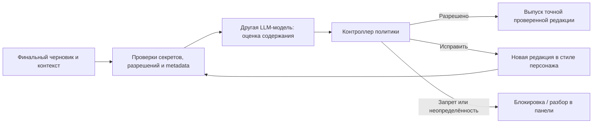

# Независимая модерация публичного контента

Статус: модуль с другой LLM-моделью и охват публичных выходов подтверждены
пользователем. Архитектурные детали ниже — предложения. Целевые регионы:
ЕС, США, СНГ, РФ. Полная правовая матрица и конкретные страны пока не определены.

## Назначение и границы

Модуль снижает риск недопустимых сообщений, речи, постов, изображений и видео.
Он использует **другую модель**, отдельный контекст и набор правил. Повторный
вызов модели персонажа с prompt «проверь себя» не выполняет это требование.
Провайдеры и ID моделей задаются конфигурацией; модель-модератор не получает
секреты или полномочия публикации.

Решение LLM не является юридическим разрешением или гарантией соблюдения
всех законов. Нужны применимые правила, проверка прав/источников, испытания
классификатора и определённый процесс разбора спорных случаев.

## Раздельные политики

1. Сюжетные и редакционные ограничения оператора.
2. Требования выбранной площадки и канала.
3. Применимые правовые требования.
4. Приватность, секреты, разрешения и права на используемые материалы.

Политика содержит версию, область применения, источник, дату проверки,
действующие ограничения, реакцию и примеры для оценки. LLM классифицирует
содержание по этим правилам; контроллер принимает и исполняет решение.
Роли персонажа/гейммастера не могут ослаблять правила через вводную или память.

Правовые пакеты учитывают конкретные страны, для США при необходимости штаты,
для ЕС право Союза и применимые национальные нормы. СНГ не является одним
единым правовым режимом. Применимость зависит от оператора, вида деятельности,
площадки, аудитории и обстоятельств. Автоматически смешивать все нормы в
универсальный prompt «законно везде» нельзя.

Неопределённая применимость или конфликт требований создают блокировку/
задачу ручного разбора по согласованной политике. Разбор не даёт универсального
права публиковать любой последующий материал. Требуемые раскрытия, маркировки
и права на материалы проверяются отдельно от смыслового содержания.

## Общий выходной шлюз

Все публичные пути подключаются к общей проверке: Minecraft-чат, голос в игре,
голос эфира, чаты YouTube/Twitch, ответы в комментариях, посты Telegram,
скриншоты/альбомы, готовые видео,
субтитры, подписи и видимые зрителям текстовые элементы. Адаптер не отправляет
черновик напрямую в обход шлюза.

Сначала локально проверяются секреты и недопустимые данные, чтобы они не
отправлялись даже внешней модели-модератору. Смысловая оценка получает
минимально достаточный контекст: адресат, канал, аудитория, предшествующая
реплика, происхождение утверждений и применимые правила.

Результат: разрешить, запросить исправление, заблокировать или передать
на разбор; ID правил, отмеченные фрагменты и краткая причина. Ответ проходит
проверку схемы. Одна самооценка уверенности модели не заменяет калибровку
на наборе примеров.

Разрешение связано с ID/hash точного артефакта, его редакцией, адресатом,
каналом, контекстом и версией правил. После изменения любого существенного
компонента нужна новая проверка. При отправке шлюз проверяет актуальность
разрешения, поколения управления и режима работы.

Повторы исправления ограничены. Персонаж может сохранить юмор и стиль при
переформулировке; модератор указывает нарушение, а не переписывает характер.
Заблокированный черновик не становится биографическим фактом и не используется
как одобренный пример развития. Журнал инцидентов хранится отдельно с
ограниченным доступом и правилами редактирования чувствительных данных.

При отказе модели, timeout, неподдерживаемом языке/формате или невалидном
ответе публичный выход не выпускается до разрешённого результата. Уже
проверенные нейтральные fallback-реплики допустимы лишь для заранее определённых
контекстов. Отказ модерации не обязан останавливать безопасное локальное
движение; публичный голос и отправка контента имеют свой режим блокировки.

## Текст, звук и изображения

Для первого голоса предлагается проверить завершённую реплику **до TTS и
проигрывания**. Прямая озвучка непроверенных токенов исключается. Последующая
оптимизация по смысловым сегментам требует отдельной проверки контекста,
границ, отмены и задержки.

Проверка текста не доказывает точность фактического аудио. TTS и маршруты
тестируются отдельно; для выбранного режима можно проверять готовое аудио
обратной транскрипцией до выпуска. Требования к этому режиму и задержке открыты.

Для изображений/видео нужна поддержка визуальной модерации и проверка реального
материала. Подписи или описания персонажа недостаточно. Модель-модератор либо
поддерживает нужные форматы, либо используются явно проверенные дополнительные
компоненты. Права на голос, модель, музыку и изображения подтверждаются
записями происхождения/лицензиями, не угадываются по картинке или аудио.

## Живое видео и чужие источники

Предварительная проверка реплик агента охватывает его речь. Изображение мира,
таблички, игровой чат, модовые элементы, чужой голос и музыка могут попасть
в эфир независимо от этой проверки.

Если требуется блокировать такой материал **до выхода**, нужен управляемый
задержанный тракт видео/аудио: буфер → анализ → решение → выпуск либо замена
безопасным источником. Допустимые задержка и нагрузка пока не определены.
Нельзя предполагать, что обычное переключение сцены удаляет уже буферизованные
кадры. Возможность управлять содержимым задержанного потока проверяется отдельно.

Доступны также ограничение источников, исключение непроверенного чужого звука,
скрытие элементов HUD/чата, ручное заглушение и безопасная сцена. Эти меры
снижают риск; постфактум переключение не отзывает уже переданный материал.
Выбранный охват живого эфира явно показывается оператору.

## Панель и проверка качества

Предлагаемый раздел модерации: очередь разбора, отклонённые/исправленные выходы,
категории и причины, версия правил, здоровье модели и режим каналов.
Во вкладке «Сюжет и развитие» видны связанные сюжетные ограничения и решения.
Ручное вмешательство фиксируется; по умолчанию оно не переписывает глобальный
запрет и не снимает законодательно обусловленное ограничение.

Набор испытаний включает русскую/английскую речь, контекстные шутки и цитаты,
обходы формулировок, разбиение реплик, ложные срабатывания, секреты/личные
данные, изображения, prompt injection, смену политики и timeout.
Измеряем пропуски, ложные блокировки и задержку отдельно по каналам.
Гарантировать безошибочность классификации нельзя.

В первой версии панели предлагается модерация текстового выхода и сюжетных
предложений с тестовыми политиками. Политики реальных публикаций, аудио и медиа
проверяются до подключения соответствующего внешнего канала.

## Первичные источники для дальнейшей правовой матрицы

Площадки имеют собственные требования: [YouTube](https://support.google.com/youtube/answer/9288567?hl=ru),
[Twitch](https://safety.twitch.tv/articles/en_US/Knowledge/Community-Guidelines),
[Telegram](https://telegram.org/tos). Для игровых материалов также проверяются
[Minecraft Usage Guidelines](https://www.minecraft.net/en-us/usage-guidelines).

Для ЕС исходные тексты для проверки требований к данным и прозрачности:
[GDPR](https://eur-lex.europa.eu/legal-content/EN/TXT/?uri=CELEX%3A32016R0679),
[AI Act](https://eur-lex.europa.eu/legal-content/EN/ALL/?uri=CELEX%3A32024R1689).
Для авторских прав в США — [U.S. Copyright Office](https://www.copyright.gov/what-is-copyright/).
Для РФ актуальные акты и поправки необходимо сверять через
[официальный портал правовой информации](https://pravo.gov.ru/).

Это отправные точки, а не полный перечень применимых законов. Некоторые
порталы/региональные страницы могут требовать отдельной проверки редакции.
Конкретная применимость, страны СНГ/ЕС, штаты США, место деятельности оператора,
аудитория и правила использования API-модератора остаются открытыми.
