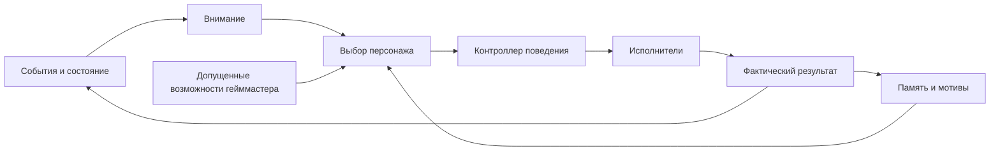

# Поведение и внимание

Статус: общий механизм согласован пользователем. Выбраны utility selection
и автоматы задач; schemas — doc17–19, параметры/границы —
[doc22](22-reference-persona.md)/[doc23](23-project-delivery-operations.md).
Это план; реализация и технические эксперименты не начаты.

## Причины действовать

Поведение строится вокруг собственных мотивов, внимания и законченных
действий. Характер проявляется в выборе занятий, тем, помощи, обязательств
и отказов. Источники инициативы:

| Источник | Пример |
| --- | --- |
| Интересы профиля | Разобраться в необычной находке |
| Незавершённые дела | Вернуться к вопросу, который не удалось решить |
| Обязательства | Показать знакомому обещанный результат |
| Отношения | Продолжить общение после совместного приключения |
| Текущее состояние | Выбрать общение или сосредоточенную деятельность |
| Возможности гейммастера | Попробовать непривычный подход в подходящей ситуации |
| Вводные оператора | Заняться темой текущей сессии |

Набор мотивов задаётся профилем. Общительность, любознательность или
стремление помогать — примеры конкретной личности, а не обязательные черты
универсального ядра. Правила изменения задаёт [модель профиля](03-character-memory.md);
конкретные свойства/пределы первого тестового профиля заданы в doc22.

## Внимание

Модуль внимания собирает актуальную картину и выделяет значимые события:
обращение к персонажу, неожиданное наблюдение, связь с текущей целью,
появление знакомого или возможности выполнить обещание, завершение задачи,
отсутствие продвижения либо потерю смысла действия.

Повторяющиеся события объединяются, устаревшие теряют актуальность.
Поток зрительских сообщений имеет ограниченный бюджет внимания;
он не должен вытеснять всю основную деятельность. Не требуется запрос
к LLM на каждое сообщение или изменение среды.

Получение события, выбор его для реакции и сохранение в долговременную
память — разные этапы. Правила источников/сроков — doc18/20/23.
Пропуск реакции не превращает неизвестный результат в известный.

## Выбор и выполнение

LLM выбирает смысл действия: продолжить разговор, исследовать находку,
вернуться к обещанию. Контроллер проверяет доступные инструменты, права,
ресурсы и актуальность; принятая задача ведётся до результата отдельным
исполнителем. Контроллер остаётся владельцем текущей цели.

У задачи есть условия завершения, срок, основания прерывания и предел
попыток. Неудача возвращает понятный результат. Затем можно изменить подход,
попросить помощь или завершить попытку. Бесконечный повтор запрещён.
Принятие команды отличается от фактического выполнения; подробнее
см. [жизненный цикл и отмену](02-architecture.md).

## Устойчивость внимания

Новое сообщение не отменяет текущую цель автоматически. При выборе учитываются:

- срочность и обязательства;
- значимость для персонажа и уместность в ситуации;
- время ожидания задачи;
- стоимость переключения;
- недавние похожие действия.

Ручная остановка и системные ограничения имеют обязательный приоритет.
Среди допустимых занятий персонаж получает свободу выбора. Точная матрица
полномочий оператора, персонажа и участников принята в doc11/19/23.

Речь и основная деятельность могут выполняться одновременно при доступных
ресурсах. Например, можно обсуждать находку во время исследования;
сложное действие может потребовать сосредоточиться. Одна активная цель
не означает обязательное последовательное выполнение всех модулей.

## Инициатива и спокойные периоды

Персонаж может возвращаться к незавершённым темам, предлагать совместные
занятия, делиться наблюдениями и начинать разговор в пределах разрешений.
Перед обращением проверяются отношения, известные ответы, предыдущие
попытки и контекст. При отсутствии ответа тема оставляется до нового
подходящего повода. Переформулировка не обнуляет историю вопроса.
Учёт собеседников и источников описан в [социальной памяти](03-character-memory.md).

Тишина допустима: наблюдение, работа или ожидание не требуют обязательной
реплики. Пауза не запускает сама по себе новый сюжет или непрерывную цепь
LLM-запросов. Интенсивность инициативы и интервалы задаются профилем
и рабочей политикой; числовые значения не выбраны.

## Влияние гейммастера и развитие

Внутренний гейммастер предлагает подходящие возможности с учётом открытых
линий и значимого опыта. Персонаж может принять, отложить либо отклонить
предложение по понятной причине. Предложение проходит сюжетные ограничения;
выбранное действие и публичный результат имеют собственные проверки.

Развитие возникает из выбора и реального результата. Пример: после
самостоятельной неудачи персонаж решает попросить знакомого о помощи;
последующий опыт может изменить готовность сотрудничать. Применение
изменения требует проверки основания и допустимых границ по
[согласованной модели личности](03-character-memory.md); параметры — doc22.

Обычные разговоры, удачные дни и спокойные занятия тоже составляют жизнь.
Каждому эпизоду не требуется конфликт, обязательный урок или изменение
профиля. Задуманное гейммастером событие не считается пережитым.

## Наблюдение в панели

Веб-панель показывает текущую цель, краткое основание выбора, ожидающие
дела и причины переключений. Это помогает увидеть влияние памяти,
отличить смену интереса от зацикливания и настроить инициативность личности.
Основания опираются на доступные события, память и правила; полный внутренний
ход рассуждений LLM не является требованием интерфейса.
Точный экран и набор управляющих элементов ещё проектируются.

## Проверка в текстовой первой версии

| Ситуация | Ожидаемый результат |
| --- | --- |
| Возвращается знакомый | Общая история влияет на продолжение подходящей темы |
| На вопрос не ответили | Нет бесконечного повторения |
| Много сообщений | Отбор обращений оставляет место основной деятельности |
| Привлекательная новая задача | Может быть отложена ради обещания |
| Возможность гейммастера не подходит | Возможен отказ или собственный вариант |
| Действие несколько раз не удалось | Меняется подход, запрашивается помощь или завершается попытка |
| Нет новых событий | Продолжается дело или наступает спокойное ожидание |

Это сценарии будущей проверки, а не выполненные тесты. Вводные и виртуальные
участники текстового MVP изолируются от реальной биографии.

## Что осталось выбрать

- Матрицу автономных действий и конкретные пределы изменения свойств профиля.
- Алгоритм выбора среди допустимых целей: правила, оценка полезности,
  структурированный выбор LLM и их сочетание.
- Конечные автоматы или деревья поведения для конкретных исполнителей.
- Бюджеты внимания/LLM, интервалы инициативы, сроки и условия переключения.
- Поля задачи, поведение при перезапуске и перечень актуальных дел.
- Точные экранные сценарии первой версии и измеримые критерии готовности.

Конкретные занятия и действия подключаются инструментами. Механизм не
зависит от Minecraft, стриминга или характера первой личности.
