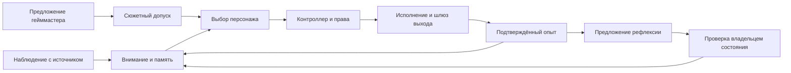

# Контракты модулей и состояния агента

Дата: 2026-10-13. Статус: семантика контрактов, состояний и паузы согласована
пользователем в D44; код и схемы API не создаются. Документ уточняет принятые
границы личности, поведения, памяти, прав, остановки, очередей и LLM.
Названия полей/состояний пока условные; точные схемы и числовые пределы впереди.
Примеры ролей и действий относятся к настраиваемой сборке персонажа;
универсальное ядро работает с зарегистрированными возможностями и контрактами.

## 1. Правило взаимодействия

Каждый модуль имеет вход, результат, владельца состояния и способ обработки
отказа. Команда запрашивает изменение; событие сообщает о зафиксированном
результате; предложение ещё не является разрешённой командой. Факт получения
сообщения подтверждает сказанное отправителем, а не истинность его утверждений.

Состояние меняет только его владелец. LLM предлагает решение в проверяемой
форме; контроллеры проверяют схему, источники, версии, права и актуальность.
Контракты доступны локальному модулю и удалённому адаптеру одинаково: транспорт,
Redis, модель и физическое размещение не входят в характер персонажа.
Логические модули MVP размещаются в согласованных core/worker/Redis;
отдельный модуль не требует отдельного контейнера или постоянно работающей LLM.

## 2. Входы, результаты и ответственность

| Модуль | Получает | Возвращает | Сохраняет / меняет | Отказ и граница |
| --- | --- | --- | --- | --- |
| Supervisor запуска | Операторскую команду, здоровье компонентов, квитанции остановки | Состояние запуска, допуск/отмену задач, новое поколение управления | Запуск, сессию, режим, остановку | При критическом отказе закрывает воздействия; STOP доступен без LLM/Redis |
| Нормализация наблюдений | Сообщение, телеметрию или тестовое событие адаптера | Наблюдение с источником, временем, происхождением и областью | Проекцию доступной среды | Некорректные входы изолируются; неизвестный автор/устаревшие данные помечаются |
| Внимание | Актуальные наблюдения, текущую цель, обязательства | Ограниченный набор значимых сигналов и их приоритет | Оперативный фокус и объединение повторов | Шум ограничивается; события не требуют LLM-вызова на каждый тик |
| Память и сборка контекста | Запрос с областью/лимитом, подтверждённые записи, предложения извлечения | Контекст с ID источников; результат сохранения/конфликт | Эпизоды, факты, версии, сводки; заменяемый индекс | Неподтверждённая запись не считается сохранённой; полнота recall видна |
| Социальная память | Проверенные идентификаторы, встречи, статусы реплик и обещания | Сведения о собеседнике, открытые темы, допустимость повторного вопроса | Связи идентичности, встречи, темы, обещания, отношения | Одинаковые ники не объединяют людей; отдельная реплика учитывается один раз |
| Состояние персонажа / контроллер развития | Команду правки, предложение изменения, источники и базовую версию | Новую версию либо ожидание решения/отказ/конфликт | Профиль, текущие состояния, историю развития | Проверяет границы; существенное изменение требует оператора; откат создаёт новую версию |
| Выбор персонажа | Профиль, допустимый контекст, возможности, допущенные предложения | Решение: продолжить, ответить, выбрать цель, отложить, отказаться или ожидать | Сам не меняет память, права и профиль | Некорректный/поздний результат отклоняется; не исполняет инструменты напрямую |
| Контроллер поведения | Решение персонажа, текущие задачи, права, ресурсы | Принятую цель/команду, переключение либо причину отказа | Текущую цель, ход деятельности и условия завершения | Удерживает задачу, ограничивает повторения; новые события не переключают её автоматически |
| Исполнитель возможности | Ограниченную команду, аргументы, аренду и условия | Прогресс и фактический результат/частичный результат/неизвестный исход | Собственное исполнение и занятый ресурс | Проверяет допуск перед воздействием; поддерживает отмену, deadline, watchdog |
| Гейммастер | Разрешённый опыт, желания, историю линий, возможности и границы | Предложение возможности с основаниями, сроком и вариантами | Линии, предложения, историю вмешательств | Не определяет чужую реакцию/исход; ограничен cooldown, сюжетным допуском и паузой |
| Рефлексия | Завершённые эпизоды, выборы, результаты, версии персонажа | Интерпретацию и предложение изменения с доказательствами либо сохранение состояния | Результат анализа; изменение применяет соответствующий владелец | Не превращает сюжетный замысел в опыт; один эпизод не получает повторного эффекта от повторной доставки |
| Политики и модерация | Конкретное предложение/действие/редакцию выхода и версии правил | Решение допуска, оценку другой модели, основания и срок | Политики — у контроллера; проверки/инциденты — у модерации | Сюжет, исполнение и публичный выпуск проверяются отдельно; сбой обязательной проверки закрывает соответствующий выход |
| Выходной шлюз и каналы | Точную редакцию, допуск, аудиторию, канал и текущие условия | Статус доставки по каждому каналу, внешний ID/квитанцию | Шлюз — допуск; адаптер — исполнение канала | Изменённый текст требует новой проверки; timeout может оставить исход неизвестным |
| LLM и учёт расходов | Задание роли, контекст, модель/параметры, лимиты и отмену | Поток, завершённый результат, отказ, usage и метаданные попытки | Попытки, назначения, версии тарифов и расходы | Различает неполный результат/неизвестный расход; секреты не выходят в события |
| Панель / журнал | Проекции владельцев и операторскую сессию | Представления, команды с ожидаемой версией | Сохраняет настройки через их владельцев | Не редактирует чужие таблицы напрямую; показывает конфликт и текущую версию |

Рефлексия может предлагать изменения нескольких видов: факт — сервису памяти,
отношение — социальной памяти, привычку — состоянию персонажа. Общее правило
развития проверяется до применения; у каждой записи остаётся один владелец.
Общая физическая БД не разрешает произвольную запись в чужие области.
Одно предложение изменения адресуется одному владельцу. Если вывод касается
нескольких областей, создаются связанные предложения с общим основанием
и собственными статусами; общего атомарного применения всех областей не предполагаем.

## 3. Минимальная форма сообщений

Общий конверт описывает:

- ID сообщения, тип и версию схемы, источник/версию адаптера;
- время возникновения и регистрации UTC, порядок источника при наличии;
- рабочее пространство, личность, пространство памяти; запуск/сессию/агента,
  когда они относятся к сообщению;
- происхождение: наблюдение, чужое сообщение, операторская вводная,
  предложение модели, интерпретация или симуляция; рабочую/тестовую область;
- trace ID, причинный ID, ID эпизода/реплики/задания при необходимости;
- полезные данные по схеме и ссылки на источники/медиа с версиями.

Большие артефакты передаются ссылками, не содержимым аудио/видео в очереди.
Конверт не содержит ключей, заголовков авторизации и секретных endpoint.
Ссылки на источники не выдают право чтения: потребитель проверяет собственный
допуск и область передачи данных в API. Входной текст остаётся данными;
операторские команды принимаются через аутентифицированный канал управления.
Удаление/исправление источника инвалидирует зависимые контексты и ожидающие
изменения. Полные тексты и технические следы подчиняются уже принятой
[политике хранения](03-character-memory.md); конверт не создаёт бессрочный
дубликат разговора. Панель показывает краткое основание по источникам и
статусам, а не требует полного внутреннего хода рассуждений LLM.

Для предложения действия дополнительно нужны цель, основания, ожидаемый
результат, применимость, приоритет, срок и требуемые возможности. Для команды —
адресат/привязка, аргументы, область полномочий, ID операции для дедупликации,
deadline, условия, токен отмены, версия политики и поколение управления.
Для результата — ID команды и попытки, версия аренды, статус, доказательства,
время и известные внешние идентификаторы. «Принято» отличается от «выполнено».

Для изменения состояния нужны ID предложения, базовая версия, конкретные
изменяемые свойства, основания, ожидаемое проявление и результаты проверок.
Свободный текст LLM не становится произвольной командой записи в БД.

## 4. Состояние агента состоит из независимых частей

Один общий статус «думает» не описывает одновременно диалог, движение,
озвучку и фоновые задания. Используются несколько независимых измерений.

### Запуск: владелец supervisor

| Состояние | Значение | Следующий переход |
| --- | --- | --- |
| STOPPED | Агентные воздействия закрыты; данные и панель доступны по здоровью служб | Только явный запуск → STARTING |
| STARTING | Проверяются профиль, пространство памяти, права, схемы, необходимые подключения | Успех → ACTIVE; отмена → STOPPING; критическая ошибка → FAULTED |
| ACTIVE | Разрешено действовать в выбранном режиме и пределах прав | STOP → STOPPING; критический отказ → FAULTED |
| STOPPING | Старые воздействия уже инвалидированы, ожидаются ограниченные квитанции остановки | Подтверждённая остановка → STOPPED; неопределённость критического ресурса → FAULTED |
| FAULTED | Воздействия закрыты; причина и неопределённые результаты видны | Исправление и явное решение оператора → STARTING либо подтверждённый STOPPED |

STOP сначала отзывает допуск и увеличивает поколение управления, затем ждёт
квитанции. Он не ждёт очереди или ответа модели. При недоступной БД runtime
и локальные исполнители всё равно закрывают управление; после восстановления
старые права/команды не восстанавливаются автоматически. Если физический
исполнитель не подтвердил остановку, панель показывает неизвестность;
истечение аренды считается подтверждением только при гарантированном её
соблюдении исполнителем. Предел ожидания и квитанции уточняются до интеграции.

### Режим, пауза и отдельные управления

| Измерение | Согласованные значения | Правило |
| --- | --- | --- |
| Область сессии | Рабочая / тестовая | Разные данные и исполнители; смена требует завершения/приостановки активного экземпляра |
| Автономия | Наблюдение / автономная работа | Наблюдение сохраняет разрешённые наблюдения, без инициативных воздействий/развития |
| Деятельность | OPEN / PAUSING / PAUSED | При паузе новые цели не запускаются; текущие воздействия завершаются в ограниченном безопасном переходе |
| Голос | Включён / отключён | Отключение прерывает вывод и очищает очередь; включение не проигрывает старые отменённые реплики |
| Гейммастер | Включён / на паузе | Пауза закрывает новые/ожидающие вмешательства; сохраняет линии и уже выбранную самостоятельную деятельность |
| Физический ресурс | Агент / оператор / свободен | Ручной захват отзывает агентную аренду ресурса, остальные допущенные возможности независимы |
| Здоровье компонента | Готов / ограничен / недоступен | Отказ необязательного компонента ограничивает его возможности; глобальный FAULTED нужен при критическом отказе |

Рабочая/тестовая область и настройки прав видны независимо от ACTIVE/STOPPED.
После возобновления проверяются текущие наблюдения и права; просроченная
очередь не проигрывается. Во время PAUSED/STOPPED разрешена
техническая фиксация уже случившегося и usage; новые автономные
изменения характера и предложения гейммастера отложены. Операторские исправления
памяти/профиля остаются отдельными явными командами. Уточнение принято в D44.
В STOPPED новые автономные LLM-задания не запускаются. В PAUSED
новая автономная рефлексия отложена до возобновления; сохранение фактов,
техническая сверка и разрешённая индексация не изменяют характер сами по себе.
PAUSING имеет конечный срок: если безопасное завершение не подтверждено,
допуск исполнителя отзывается и ошибка показывается оператору. Ожидание
безопасного перехода не превращается в бессрочное продолжение воздействия.

### Текущая деятельность: владелец контроллер поведения

Основная цель может отсутствовать, выбираться, выполняться или ждать
конкретного условия; она всегда ссылается на задание и основание. Рядом
показываются независимые задачи речи, модерации, памяти и генерации.
«Ожидает ответа модератора» описывает реплику, а не запрещает все другие
допустимые действия. Спокойное ожидание — нормальный исход выбора.

## 5. Задания, доставка и поздние результаты

| Статус операции | Что произошло |
| --- | --- |
| PROPOSED | Есть предложение; исполнения ещё нет |
| AWAITING_APPROVAL | Нужен операторский допуск конкретного результата |
| READY | Предусловия проверены, выполнение допустимо до указанного срока |
| QUEUED | Задание сохранено и ожидает исполнителя; доставка отслеживается отдельно |
| RUNNING | Получена актуальная аренда/попытка, идёт выполнение |
| WAITING | Ожидается именованное условие с конечным сроком |
| SUCCEEDED | Есть подтверждённый результат |
| REJECTED / FAILED | Допуск отклонён либо разрешённая попытка закончилась неудачей |
| CANCELLED / EXPIRED | Операция отменена либо истёк её срок |
| OUTCOME_UNKNOWN | Воздействие могло произойти; нужен разбор/сверка, а не слепой повтор |

Это общий словарь, а не обязательный маршрут всех операций. Простое разрешённое
чтение может пройти READY → RUNNING → SUCCEEDED без брокера. Durable-задания
проходят сохранение/outbox/очередь по [плану доставки](15-docker-queues.md).
Состояние Redis-доставки, состояние задачи и оплаченная API-попытка различаются.
Ожидание одобрения ещё не разрешает исполнение; READY заново проверяется
перед воздействием. WAITING всегда имеет причину/событие пробуждения и deadline.

Конечные результаты сохраняются владельцем; событие о результате попадает
в его outbox в той же транзакции. Повтор сообщения возвращает уже известный
результат для ID операции. ID доставки не заменяет ID смысловой операции.
Временная ошибка допускает конечный повтор; постоянный отказ схемы/прав —
понятный отказ без повторного обращения к LLM. OUTCOME_UNKNOWN уточняется
отдельной записью сверки с сохранением истории; внешний повтор допустим
только после проверки идемпотентности/доставки.
FAILED означает завершённую операцию; временная ошибка отдельной попытки
переводит допускающее повтор задание в ограниченное ожидание/очередь,
сохраняя ошибку попытки и её расход. Повтор не создаёт новую цель или обещание.

Проверки свежести используют запуск, поколение управления, версии профиля/
политики/источников и аренду попытки. Новый запуск получает новый ID;
перезапуск не делает старый ответ актуальным при совпадении числового счётчика.
Отзыв одного ресурса/права инвалидирует свою область; STOP — весь выбранный агент.

Поздний ответ модели после STOP не запускает реплику или развитие. Поздний usage
может обновить финансовый журнал; поздняя квитанция уже отправленного сообщения
может уточнить историю доставки. Эта техническая сверка не возобновляет агента
и не отменяет фактически случившееся. Завершённые ранее изменения остаются в
истории; STOP сам по себе не является откатом профиля или удалением памяти.

Между владельцами нет общей транзакции с внешними API/индексом. Каждая стадия
фиксирует свой результат и событие; следующий владелец обрабатывает ID повторяемо.
Для одной области состояния используются ожидаемая версия и разрешение конфликта,
а не предположение об общем порядке всех сообщений. Повторная обработка старого
эпизода после нового опыта допускается только как явный пересмотр с новой версией.

## 6. Реплика и публичный выход

У реплики один ID и точная редакция с каналами/аудиторией. Согласованный цикл:
черновик → проверка → одобрение либо блокировка → допуск шлюза → доставка
по каждому каналу. Проверка связывается с редакцией/хешем, аудиторией,
правилами, контекстом, сроком и поколением управления. Изменение текста/медиа
или существенных условий требует новой проверки. Операторский допуск Telegram
и модерация содержания — независимые условия.

Streaming в приватной панели показывает предварительный текст и окончательный
статус. Публичный канал получает завершённую одобренную редакцию. Частичный JSON
не исполняет инструмент. TTS, игровой чат и другие каналы получают свои команды
через шлюз, сохраняя общий ID реплики. Модератор использует другую модель.

Доставка по каналу имеет QUEUED / SENDING / DELIVERED / PARTIAL / FAILED /
CANCELLED / UNKNOWN по возможностям адаптера. Для голоса фиксируются начало,
завершение/прерывание проигрывания; они не доказывают, что человек услышал слова.
История «сказал/опубликовал» опирается на подтверждённый статус, а не черновик.

Перед вопросом социальная память проверяет известный ответ, тему, уже ожидающий
вопрос, cooldown и просьбу оставить человека в покое. На время допуска/отправки
резервируется тема, чтобы параллельные задачи не задали её дважды. Блокированный
черновик не становится реально заданным вопросом; UNKNOWN сохраняет осторожное
ожидание сверки. Голос+чат — одна реплика с двумя статусами доставки, одним
обещанием/социальным эффектом. Обещание агента фиксируется по событию его
доставленной реплики; LLM-черновик не создаёт обещания собеседнику.

## 7. Возможность гейммастера и изменение персонажа

Предложение гейммастера содержит линию, основания, применимость, границы,
срок и доступные возможности. Пример состояний: DRAFT → SCREENED → OFFERED →
ACCEPTED → REALIZING → RESOLVED; возможны BLOCKED, DECLINED, EXPIRED, CANCELLED.
SCREENED означает сюжетный допуск, ACCEPTED — собственный выбор персонажа,
а реальное действие отдельно допускает контроллер поведения. История линии
сохраняется; её пауза/закрытие не стирает прожитые эпизоды.

Рефлексия получает источники действительно пережитых эпизодов в своей области.
Её результат содержит интерпретацию, неопределённость, ID доказательств,
базовую версию и конкретное предложение изменения либо «сохранить состояние».
Согласованный цикл изменения: PROPOSED → VALIDATING → READY или AWAITING_APPROVAL →
APPLIED; альтернативы REJECTED, CONFLICT, CANCELLED. READY не является применением.

Владелец проверяет происхождение доказательств, допустимые свойства, темп/
накопленный предел изменений, сюжетные ограничения и версию. При устаревшей
версии нужен пересмотр; слепое применение старой правки исключается. Значимые
изменения опорных ценностей/идентичности передаются оператору. Повтор доставки
одного изменения не создаёт новый эффект; повтор анализа помечается пересмотром.

Применение создаёт новую версию с основаниями и ожидаемым проявлением.
Результат поведения затем проверяет, проявилось ли изменение. Откат создаёт
новую запись с предварительным показом зависимостей; не переписывает события
и сказанные слова задним числом. Контракт не требует обязательного развития
после каждого разговора; основанный на опыте отказ от изменения — полноценный результат.
Применение изменения и запись сводки не являются новым пережитым эпизодом,
автоматически запускающим ещё одну рефлексию. У цепочки есть причинные ID,
конечные задания и лимиты; технические события не создают бесконечный цикл
«рефлексия → запись → рефлексия».

## 8. Один сквозной сценарий первой версии

Пример выполняется в лаборатории с тестовой личностью и виртуальным собеседником
Никой. Это иллюстрация, а не заданный канон/характер. Исходные ID и память тестовые;
события симулятора не становятся рабочей биографией.

| Шаг | Действие и владелец | Что остаётся после шага |
| --- | --- | --- |
| 1. Знакомство | Адаптер принимает сообщение Ники; нормализация фиксирует источник; социальная память использует подтверждённый ID | Тестовая встреча и сказанное, без догадки о реальной личности/истинности всех слов |
| 2. Диалог | Внимание выбирает сообщение; память собирает ограниченный контекст; персонаж предлагает ответ | Решение и черновик с источниками; LLM-попытка/usage учитываются отдельно |
| 3. Обещание | Персонаж предлагает помочь сравнить две идеи; контроллер проверяет уместность; другой модератор проверяет реплику; симулятор канала подтверждает доставку | Одна доставленная тестовая реплика и открытое обещание; блокированный черновик не создаёт обязательства |
| 4. Повторная встреча | После возобновления социальная память находит тот же ID и обещание; контекст включает прежний разговор | Продолжение темы без повторного знакомства/того же вопроса |
| 5. Возможность | Гейммастер по событию и cooldown предлагает вернуться к обещанию; сюжетный допуск проверяет основания/границы | Допущенная возможность; исход остаётся открытым |
| 6. Собственный выбор | Персонаж выбирает помочь сейчас, отложить или отказаться; контроллер проверяет ресурсы, срок и права | Принятая задача либо зафиксированный выбор с основанием; отказ не порождает бесконечные новые предложения |
| 7. Результат | Тестовая среда возвращает конкретный ответ Ники; память сохраняет выбор, ответ и исход | Пережитый тестовый эпизод; обещание закрывается только при подходящем результате |
| 8. Рефлексия | Анализ связывает эпизод с прежним опытом и предлагает небольшое изменение либо сохранение состояния | Предложение с доказательствами; одно обещание не объявляется автоматически устойчивой новой чертой |
| 9. Развитие | Владелец проверяет базовую версию/границы; применяет допустимое изменение или ждёт оператора/отклоняет | Карточка до/после, источники, ожидаемое проявление и история; обновлённые сведения поступят в будущий контекст |
| 10. STOP и возвращение | Supervisor отзывает поколения/команды; поздние ответы закрываются; новый запуск проверяет данные/права | Сохранённый опыт и расходы, явное возобновление, актуальная задача после новой проверки |

Гейммастер, рефлексия и индексация вызываются по событию/расписанию/значимости
и отдельным лимитам; весь маршрут не обязан выполняться на каждую реплику.
Публичная модерация сохраняет обязательность по политике независимо от нагрузки.

## 9. Будущие проверки контрактов

| Ситуация | Ожидаемое поведение |
| --- | --- |
| Повтор входа/события результата | Одна смысловая запись; состояние не меняется второй раз |
| Новая формулировка прежнего вопроса / два параллельных ответа | Проверка темы и резерв предотвращают повторное обращение |
| Рабочий читатель запрашивает тестовый/чужой источник | Доступ отклонён; смена имени профиля не объединяет биографии |
| STOP при генерации/модерации/развитии | Поздний ответ не исполняется; usage/квитанции могут уточнить учёт |
| Отказ Redis или заполненная очередь | STOP работает напрямую; сохраняемые задания ограничены и видны |
| Отказ БД / неподтверждённое сохранение обещания | Надёжное продолжение задачи закрыто; панель показывает сбой, а не успешное запоминание |
| Результат старой аренды после нового исполнителя | Коммит результата отклонён; технические квитанции разбираются отдельно |
| Правка профиля/политики во время работы модели | Изменение/воздействие проверяется по новой версии; старое одобрение не выдаёт актуальный допуск |
| Сбой модератора / смена текста после проверки | Соответствующий публичный выход закрыт; другие разрешённые действия независимы |
| Голос прерван, чат доставлен | Разные статусы каналов и один социальный эффект; услышанное не выдумывается |
| Публикация отправлена, ответ потерян | UNKNOWN и сверка; слепой повтор не создаёт второй пост |
| Гейммастер на паузе / предложение отклонено | Новые вмешательства закрыты; самостоятельная задача и история продолжают учитываться |
| Новая версия после предложения развития / повтор обработки эпизода | Конфликт или явный пересмотр; ограничения накопленного изменения сохраняются |
| Перезапуск / сон Windows | Проверка свежести и поколений; управление автоматически не включается |

Это критерии будущих испытаний; тесты и API-вызовы сейчас не выполнялись.

## 10. Согласованная семантика и следующий уровень детализации

Согласованы в D44: единый владелец каждой области, разные сообщения
предложения/команды/результата, независимые измерения состояния, проверяемый
путь опыта и развития, техническая сверка после STOP без возобновления действий.
Остаются точные схемы полей, пороги/сроки и критерии критичности компонентов,
частота рефлексии, контракты конкретных возможностей и интерфейс конфликтов.
[Логическая модель данных](18-data-model.md) принята в D45. Следующий проект
для обсуждения — [минимальные поля/API](19-api-contracts.md), затем
реализационные библиотеки и ограниченные проверки стека.
