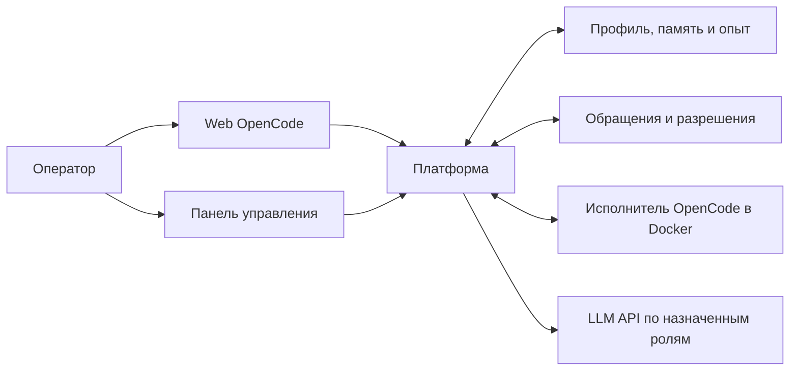

# Знакомство с AI Agent Platform

Это рабочее место для ИИ-персонажей: профиль задаёт характер, память сохраняет
опыт, а инструменты позволяют выполнять поручения. Опечатка — первый публичный
[пример персонажа](../profiles/examples/opechatka/profile.md), а не имя,
зашитое в платформу. Одновременно исполняется один активный персонаж.

## Что открыть

1. **Web OpenCode** — общение, поручения, разговоры разных персонажей и файлы.
2. **Панель** — состояние, START/STOP, профиль, память, расходы и обращения.
3. **Обращения** — ответы оператору и решения о новых возможностях или правах.

На подготовленном Windows-компьютере запуск начинается с Docker Desktop и
[Start-Panel.cmd](../Start-Panel.cmd). После входа сервер остаётся STOPPED;
работа начинается по START. Закрытие вкладки не заменяет STOP.
Настройка новой установки описана в [README](../README.md#как-запустить).

## Как связаны части

Платформа связывает оба контура одной личности, ведёт бюджет и проверяет
исполнение. Возможности зависят от настройки конкретного host. Minecraft,
Telegram, голос и аватар не становятся подключёнными только от просьбы в чате.
Новое [рабочее пространство v2](31-agent-workspace-v2.md) развивается отдельными
поставками; наличие кода в main не означает обновления личной установки.

## Короткий показ

- Откройте публичный профиль и объясните, что характер — настраиваемые данные.
- В отдельном демонстрационном разговоре поручите небольшую задачу на
  вымышленных материалах. Покажите фактические шаги и результат, если журнал
  хода подключён в этой установке.
- Покажите память и расходы, затем обращения и границы выданных возможностей.
- Нажмите STOP и покажите, что новый запуск требует START.

Для демонстрации без оплачиваемых вызовов есть mock-пример в README.
Он не воспроизводит весь автономный рабочий контур. Личный разговор, память и
подключение к платному провайдеру не следует выдавать за синтетический стенд.

## Что передавать другим

Передавайте ссылку на GitHub или архив **отслеживаемых исходников** (`git archive`).
В него входят код, документы, лицензии и публичные примеры. Получатель отдельно
устанавливает зависимости и настраивает собственный host.

Не копируйте всю рабочую папку разработчика: `.env`, `config/local.*`, `runtime/`,
базы, резервные копии, виртуальные окружения и сборки принадлежат локальной
установке. Большой размер такой папки не равен размеру исходного проекта.

Исторические [отчёты](implementation-reports/) сохранены как свидетельства
проверок на момент сдачи. Для первого знакомства достаточно этой страницы,
README и инструкции запуска; читать все отчёты подряд не требуется.
